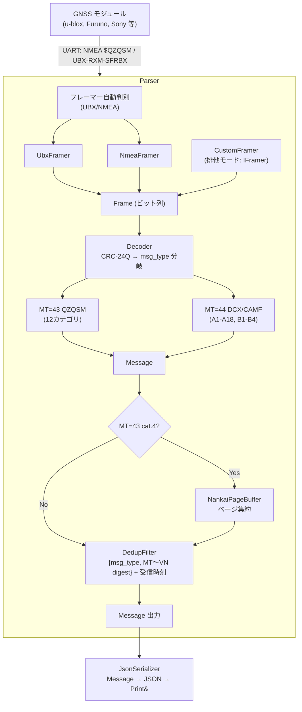
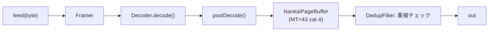
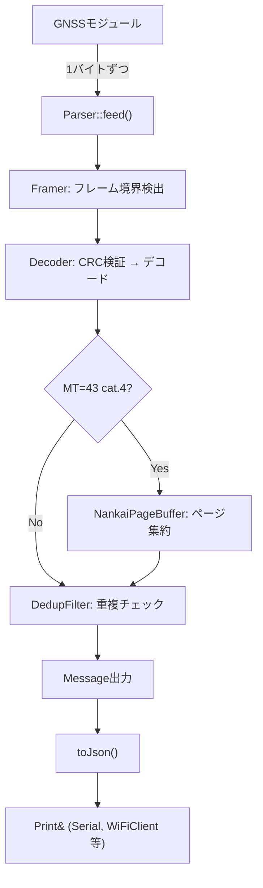

# azaraCアーキテクチャドキュメント

## 概要

azaraCは準天頂衛星システム（QZSS）のL1S信号から災危通報メッセージをデコードするArduinoライブラリである。
本ドキュメントでは、ライブラリの内部アーキテクチャと設計思想について解説する。

ファイル構成は[開発者ガイド](developer-guide.md#プロジェクト構造)を参照すること。

## システム構成図（概略）

## コンポーネント詳細

### 1. Parser (パーサー)

[`Parser`](https://github.com/A-vrice/azaraC/tree/main/src/Parser.h)はライブラリのメインエントリーポイントである。

- **フレーマー自動判別**: 入力バイトストリームからUBX/NMEAを自動判別（UBX同期文字`0xB5 0x62`、NMEA`$`文字で判定）
- **メッセージデコード**: フレームの復号とCRC検証
- **重複除去（全メッセージ）+ 南海トラフ集約**: `postDecode()` が全メッセージ共通の重複チェックとメッセージ出力を担当する。
  また、MT=43 cat.4のページ集約（`NankaiPageBuffer`）と事象鍵（`info_code` + 情報種別 + Rc + 報告時刻）生成も一元管理する。
  重複判定は南海トラフの集約結果だけでなく、電文すべてに適用される。

### 2. Framer (フレーマー)

[`IFramer`](https://github.com/A-vrice/azaraC/tree/main/src/framer/IFramer.h)インターフェースを実装:

| フレーマー | プロトコル | 対応デバイス |
|-----------|-----------|-------------|
| [`UbxFramer`](https://github.com/A-vrice/azaraC/tree/main/src/framer/UbxFramer.h) | UBX-RXM-SFRBX | u-blox M10, ZED-F9P |
| [`NmeaFramer`](https://github.com/A-vrice/azaraC/tree/main/src/framer/NmeaFramer.h) | NMEA $QZQSM | Furuno GT-87, 汎用GNSS, Sony Spresense |
| カスタム (IFramer) | 任意 | Sony, その他 |

`Frame::svid` にはQZSS L1SのPRNが入る。
Satellite IDは「PRNを表す8bitの下位6bit」（IS-QZSS-DCR-017 §4.3.1）なので、`NmeaFramer` は受け取った値に `svid | 0x80` を適用してPRNに直す（仕様上有効なSatellite ID 53–63 → PRN 181–191）。
2桁でも6bitに収まらない64–99は拒否し、0–52は6bitとしては通すがPRN 128–180でQZSSの割り当て外である。
`UbxFramer` は `ublox_qzss_svid_prn_map` に該当する場合だけPRNへ変換し、181–191はこの変換後のQZSS PRNに限る。
表に無い `svId` は範囲外の値を含めて入力値のまま通す。
`JsonSerializer` は `svid` を数値のまま出力し、ラベルは付けない。

### 3. Decoder (デコーダー)

[`Decoder`](https://github.com/A-vrice/azaraC/tree/main/src/decoder/Decoder.h)はビット列からメッセージフィールドを抽出する。

**共通処理**: CRC-24Q検証（IS-QZSS-L1S-009 §4.1.1.3）、MSB-firstビット抽出、UNIX時刻ベースの年月補正。

**MT=43**: `DecoderQzqsm`がX-macroテーブル`AZARAC_DC_CATEGORIES`から全12カテゴリのサポート判定・ディスパッチを生成。
カテゴリ一覧は[APIリファレンス](api-reference.md#mt43datamt43-qzqsm)を参照。

**MT=44**: 階層構造のCAMFフォーマット（A1-A18 + B1-B4拡張）を解析。
サービス種別（L-Alert, J-Alert等）の判定条件は[APIリファレンス](api-reference.md#mt44datamt44-dcxcamf)を参照。

### 4. DedupFilter (重複除去)

[`DedupFilter`](https://github.com/A-vrice/azaraC/tree/main/src/internal/Dedup.h)はアプリケーションノートv2の方式にのっとっている。

- **MT～VNで判定**: 発信元衛星によらず重複処理をするため、メッセージ本文のみを判定に使う。
  MT～VNフィールド（フレーム内bit 8..219、計212bit）のCRC-24Qを保存する。
  ただしMT=44（DCX/CAMF）のSD（SDMT bit 14・SDM bit 15..23）は照合範囲に含めない。
  ゼロにしてからCRCを取る（QZS事務局回答の照合範囲は「MTおよびCAMF〜EM」）。
  衝突の可能性は残るが、メモリ効率を優先してこの方式にしている。
- **メッセージの保存期間**: 一定時間受信しなかった情報は履歴から削除するため、種別ごとの `window_ms` 以内に再受信したものを重複として扱う。
  再受信のたびに有効時間は更新され、1通に複数種類のメッセージが入る場合は条件を満たすうち最長のものを採用する。
  MT=43はアプリケーションノートの配信終了条件（p.26-27）、MT=44（CAMF）はA8-Hazard Durationの上限（UnknownはDCX §5.4により1週間）を有効期限とする。
  AVRでは `AZARAC_DEDUP_MT44_MAX_WINDOW_MS`（既定5分）で頭打ちにする。
  スロットが64と少なく、7日の窓は生きた情報の枠を占め続けて押し出しを招くためである（MT=44の再送間隔は最大16秒）。
  表に無いカテゴリは `AZARAC_DEDUP_WINDOW_MS` を使う。
- **内部スキーマ**: セットアソシアティブ表（`AZARAC_DEDUP_SLOTS`÷`AZARAC_DEDUP_WAYS`セット）。
  満杯時は同一セット内の最も古い情報を置換する。
  受信当たりの走査は`WAYS`回で固定のため、`SLOTS`を増やしても計算コストが比例することはない。
- **容量不足時の挙動**: 容量が不足すると最も古い情報から置換されるため、置換後に同じ情報を再受信すると重複と見なされず再通知される。
  生きている情報を重複と誤判定して通知を落とすことはない。

  スロット数の根拠（2024年のアーカイブから選んだ30日分、`make -C test dedup-realday`）:

  | 同時メッセージ数 | 日数 | 256×8での再通知 | 512×8での再通知 |
  |---|---|---|---|
  | 20–50 | 11 | 0 | 0 |
  | 51–100 | 13 | 0 | 0 |
  | 101–130 | 3 | 0 | 0 |
  | 327（2024-08-28） | 1 | 2 | 0 |

  同時メッセージ数は 20–327（中央値66）で、256×8の再通知は最悪日の2件のみ、512×8では30日すべてで取りこぼしも再通知もない。
  日別の内訳（`AZARAC_DEDUP_WAYS=8`）:

  | 日 | distinct | 最大同時メッセージ数 | 64×8 | 128×8 | 256×8 | 512×8 |
  |---|---|---|---|---|---|---|
  | 2024-01-01（能登） | 162 | 75 | 52 | 0 | 0 | 0 |
  | 2024-04-02 | 34 | 33 | 0 | 0 | 0 | 0 |
  | 2024-07-24 | 237 | 95 | 1 | 1 | 0 | 0 |
  | 2024-08-07 | 106 | 68 | 1 | 0 | 0 | 0 |
  | 2024-08-28（台風10号） | 456 | 327 | 6 | 2 | 2 | 0 |

  最大同時メッセージ数がスロット数のおおむね1/2を超えると再通知が出始める。
  最悪日（08-28）は同時327件で、256×8でも2件再通知が残った。
  能登半島地震のような瞬発的な通知が多い日は128×8で足りるが、台風のように地域別で細かく予報が出る日は足りない。
  南海トラフ本震のような、これを超える同時メッセージ数のシナリオは未検証。

  能登（2024-01-01）のカテゴリ別内訳:

  | 容量 | 全体 | 震源(2) | 震度(3) | 降灰(9) | 海上(14) |
  |---|---|---|---|---|---|
  | 16×8 (128 B) | 750 | 227 | 279 | 59 | 185 |
  | 32×8 (256 B) | 329 | 96 | 128 | 25 | 80 |
  | 64×8 (512 B) | 52 | 9 | 33 | 7 | 3 |
  | 128×8 (1 KB) | 0 | 0 | 0 | 0 | 0 |

  影響は同時メッセージ数で決まる。
  16×8の再通知は震度279件（保存期間内のメッセージはピークで36件）> 震源227件 > 海上185件 > 降灰59件の順。
  緊急地震速報1件（有効期限5分・期限内4件）と津波5件（期限内12種）は16×8でも再通知0。
  よって必要スロット数は再放送の回数ではなく保存期間内のメッセージが支配する（津波は6,872通と最多だが生存12種のみ）。

  残る2カテゴリはこの計測の対象外:

  - **南海トラフ(4)**: 重複判定はMT～VNフィールドではなく`info_code` + 報告時刻で判定を行うため対象外。詳細は後述。
  - **北西太平洋津波(6)**: 選んだ30日には出現しないため、`test/data/test_realdata_generated.cpp` の個別ケースで検証。

  `.l1s` は衛星別なので、同じ日でも衛星によって内容が違う（例2024-08-07: Q002はdistinct 106・生存ピーク68、Q005は148・110）。
  
- **既定値**: 512スロット×8ウェイ = 4KB。
  30日アーカイブすべてでFALSE_RE=0 / MISSED=0。
  256×8でも再通知が残るのは最悪日（同時327件）だけなので、余裕を見るなら512スロット、受信カテゴリを絞れるなら128スロットでも足りる。
  AVRプリセットは64×8 = 512B。
  対象は震度・津波に絞られるため、気象・台風が主体の日であふれることはない。
- **南海トラフでの重複判定**: 集約メッセージは情報一件ごと（`info_code` + `information_type` + `report_classification` + 報告時刻）で識別する。
  到着順でどのページが最後になるかは変わるため、集約済みテキストによる判定では同じ事象を再放送のたびに別情報と判定してしまう。
  電文鍵とは `DedupKey::synthetic` で名前空間を分けるので、値が一致しても衝突しない。
  事象鍵は7フィールド29ビット（`dedupEventToken`）で、集約バッファの鍵（`NankaiPageKey`）と同一である。
  `information_type` を含むのは、同一 `info_code` + 同一報告時刻の発表（窓24時間）と取消（窓2時間）を別の情報として扱い、取消が発表の履歴に潰されないようにするためである（含めないと、集約バッファでも両者のページが混ざる）。
  `report_classification`（Rc）を含めるのは、訓練/試験（7）が実警報（2）を抑止したり、両者のページ本文が同じ集約バッファで連結されたりするのを防ぐためである。
  完成済み事象の再送ページは本文を再出力せず、dedupの履歴だけを更新する。`AZARAC_ENABLE_DEDUP=0` でもNankaiのページビットマップによる重複抑制は残る。
- **32 bit時刻の折り返し**: `Parser` は64 bitの受信時刻を監視し、通常の32 bit折り返しは `DedupFilter`/`NankaiPageBuffer` の符号なし差分で扱う。
  1,000 ms（1秒）以内の時計後退は受信順序の揺らぎとして丸め、それを超える後退（時計の再設定）、または64 bit時刻の上位32 bit（世代）が変わったときにdedup/Nankaiの履歴を捨てる（再通知は許容し、生きた警報の抑止を避けるためである）。
  世代比較により、連続受信で49.7日（2³² ms）経過してエントリの年齢が巻き戻る場合も確実に履歴を捨て、古い履歴の偽重複による抑止を防ぐ。
  受信が無い期間は `Parser::updateClock()` を `loop()` などから定期的に呼ぶこと。AVRなど32 bit `millis()` だけの環境では、周期的な観測が無いまま2³² ms以上空くと折り返し回数を復元できない（ESP32は64 bitの `esp_timer` を使うため不要である）。
  dedupとNankaiを両方無効にすると `Parser` の64 bit最終観測時刻メンバは存在しなくなり、8 B分減る。
  `DedupFilter::Entry` は8 B、AVRのdedup RAMは512 Bのままである。

### 5. NankaiPageBuffer (南海トラフページ集約)

[`NankaiPageBuffer`](https://github.com/A-vrice/azaraC/tree/main/src/internal/NankaiPageBuffer.h)は最大63ページに分割される南海トラフ地震メッセージを集約する。
`MAX_PAGES×18+1` バイトを確保し、受信したページをビットマップで管理しながら直接書き込む（ソート不要）。
管理は `NankaiPageBufferManager` が担い、集約キーは `{info_code, information_type, report_classification, report_time（month/day/hour/minute）}` である（訓練/実警報の分離はPR #45のF-1/F-2を参照）。

| マクロ | 既定 | 説明 |
|--------|------|------|
| `AZARAC_NANKAI_MAX_PAGES` | 63 | 1電文あたりの最大ページ数（仕様上の最大も63） |
| `AZARAC_NANKAI_BUFFERS` | 2 | 同時に追跡できる事象の数（AVRプリセットは1。訓練/実警報の同時進行に2必要） |

メモリ使用量: バッファあたりメタデータ24 B（AVRは23 B）+ `MAX_PAGES×18+1` B。既定63ページで構造体サイズはアラインメント込み1,160 B（AVRは1,158 B）、2バッファで約2.32 KB。バッファ数に比例する（4バッファ・63ページで4,640 B）。

追い出し（エビクション）: 全バッファ使用中は、まず訓練・試験（Rc=7）のバッファから最終更新が最も古いものを解放する。訓練バッファが無い場合、到着した訓練のページは実警報を守るため破棄され、実警報のページであれば実警報同士で最終更新が最も古いものを解放する（同値なら先頭スロット。厳密なLRUではない）。
そのため `BUFFERS=1` でも進行中の実警報が訓練で中断されることはない。バッファ数を超える実警報の同時進行には従来どおりの限界があり、60秒タイムアウトがメモリ上限を保証する。

### 6. JsonSerializer (JSONシリアライザ)

[`JsonSerializer`](https://github.com/A-vrice/azaraC/tree/main/src/json/JsonSerializer.h)はMessageをJSONにシリアライズする。
ヒープ割り当てはせず、`Print&` 経由で出力（Serial、WiFiClient等）。
日本語/英語ラベルは選択的コンパイルに対応する。
キーと固定値リテラルは `internal::JsonKey`（`AZARAC_KEY("...")`）で受け、AVRでは `PSTR` でFlashに置く（素のリテラルはavr-libcのリンカスクリプトが `.rodata` ごと `.data`＝SRAMに置くため）。
書き出しはキーも値もFlashから走査し、キーは必要ならスタックの一時バッファ（`AZARAC_KEY_BUF_SIZE`）へ1度写して出す。
日本語/英語ラベルは、非AVRの単一ラベルの引き当てがゼロコピーの `string_view`、それ以外（AVRでの参照と2/3分割ラベルの連結）は共有バッファ（`AZARAC_FLASH_BUF_SIZE`）へ1度コピーして扱う。
共有バッファは1本なので、`toJson()` と定義テーブルの参照を、複数のタスクやスレッドから同時に行わないこと。

## データフロー

## メモリ設計

| コンポーネント | メモリ使用量 | 備考 |
|---------------|-------------|------|
| DedupFilter | `AZARAC_DEDUP_SLOTS × 8` B | 既定4,096 B（512スロット）／AVRプリセット512 B。1エントリ = identity 4 B + 受信時刻4 B |
| Message | 84 B（AVR。DCX/CAMF追加で199 B）／240 B（ホスト・全カテゴリ） | payload枠は有効カテゴリ最大の `sizeof` に `alignas(uint64_t)` を付けた `Mt43Data`。スケッチがグローバルに1個持つとそのまま `.bss` になる |
| NankaiPageBuffer | メタ24 B（ホスト）／23 B（AVR）+ `MAX_PAGES × 18 + 1` B | 既定63ページで1,160 B（AVR 1,158 B）。AVR既定4ページで96 B。LRUで追い出し |
| 定義テーブル | 293,152 B（エントリ行105,488 + 文字列・断片プール187,664、285セクション） | 読み取り専用セクション合計は336,304 B。AVRプリセット（SEISMIC/TSUNAMI、JA）は表 + プールで3,011 B |

計測条件: 全カテゴリ + 日英ラベル有効、64 bitホスト `g++ 15.2 -std=c++17 -O2 -fdata-sections`（生成対象外の4表を含む）。
AVR側は `test/bench/avr/measure_tables.py`。

**Flash配置**: 表はAVR/非AVR同一の生成コードで、表ごとに文字列プール＋共有断片プール（factor_parents、`scripts/gen/strategy.py`）を持ち、行は `{id, 親, offset}` の3フィールド（長さはプールのNUL区切りから取る）。
単一ラベルの引き当ては非AVRではゼロコピーの `string_view`、2/3分割ラベルは共有バッファ（`AZARAC_FLASH_BUF_SIZE`）への1回コピーで連結する。

Flashが64 KiBを超える品では、表・プールを `.text.azaraC.<N>`（`*(.text.*)`、コードの後ろ）に置く。
`.text` 先頭の `*(.progmem.*)` には置かない（`AZARAC_PROGMEM`）。
Arduinoは `core.a` を最後にリンクするため、先頭クラスタに116 KiBの表があるとコア自身のPROGMEM（`digital_pin_to_port_PGM` 等）が16 bit窓の外へ押し出される。
これにより `pinMode`/`digitalWrite` が誤動作する。
アドレスは32 bitのFlashアドレスで扱う（`AZARAC_PGM_PTR` + `pgm_read_*_far` / `memcpy_PF`）。

**payload枠の大きさ**: `Mt43Data::storage_size_` は有効カテゴリのpayload型 `sizeof` の最大値（コンパイル時 `constexpr`）。
AVRプリセットでは最大が津波（62 B）なので `sizeof(Mt43Data)` は75 B、`Message` は84 B（DCX/CAMF有効時は `Mt44Data` が最大になり `Message` 199 B）。
12種類のpayload型すべてが `AZARAC_ENABLE_*` で定義ごとガードしてあるため、カテゴリを無効にするとRAM枠も連動して縮む。ホストでの実測では、津波系を無効にすると `storage_size_` は88→56 B、全無効では1 Bになる。全無効でも `storage_` が空配列にならないよう、1 Bに切り上げている。
`EewData`（予報区は `region_bitmap[10]` 保持で34 B）は `AZARAC_ENABLE_EEW` でガード。
payload型はどれも `alignas(uint64_t)` だが、AVRの `alignof(uint64_t)` は1なので実サイズは切り上がらない（ホストは8）。
ガードの追加箇所は開発者ガイドの「カテゴリ無効時の型ガード」を参照。

**LTOの制約（AVR）**: ArduinoのAVRコアは `-flto` でコンパイル・リンクする。
inline関数内の `static const char[]` はone-onlyシンボルになり、LTOでは `__section__` が落ちて `.rodata`（リンカスクリプト上 `.data`、実体はSRAM）へ移る。
そのため生成ヘッダのswitch戦略はcaseリテラルを名前空間スコープの配列として出す。
`make -C test bench` のstage 5がArduinoレシピ（`-flto`）でリンクしたMega画像のSRAMをゲートする（`MEGA_RAM_BYTES` ≤ 892B）。

## 関連ドキュメント

- [APIリファレンス](api-reference.md)
- [開発者ガイド](developer-guide.md)
